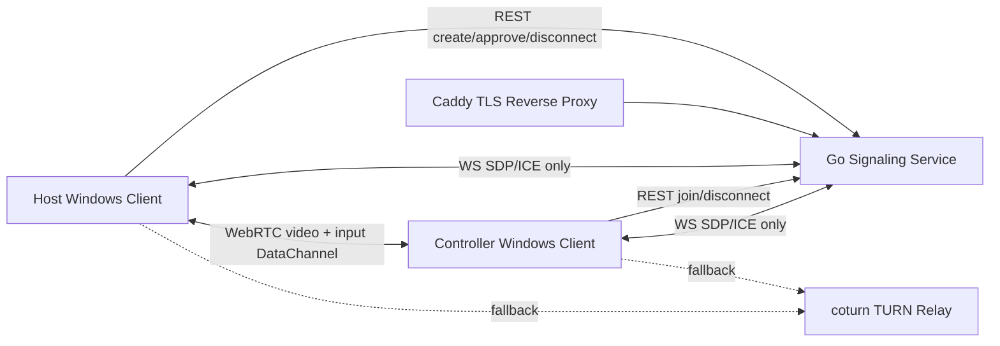

# Architecture

RemoteAssist has three parts:

- A Tauri v2 desktop client with React UI and Rust commands.
- A Go signaling service for temporary session state, REST APIs, ICE config, and SDP/ICE WebSocket forwarding.
- A deployment package with Caddy TLS reverse proxy and coturn relay.

The signaling service never receives screen pixels or keyboard content. Video travels through WebRTC. Remote input travels through a WebRTC DataChannel only after host approval and is revalidated on the host before `SendInput`.
