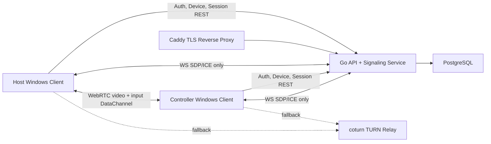

# Architecture

RemoteAssist has three parts:

- A Tauri v2 desktop client with React UI and Rust commands.
- A Go API and signaling service for authentication, devices, temporary session state, ICE config, and SDP/ICE WebSocket forwarding.
- A deployment package with Caddy TLS reverse proxy and coturn relay.

The 0.5 client separates session orchestration (`App.tsx`), account/device pages (`pages.tsx`), reusable interaction/viewer components (`ui.tsx`), and testable formatting/layout policy (`ux.ts`). Layout uses CSS tokens, intrinsic grids, container queries and logical properties. The remote viewer measures its container and received video separately with ResizeObserver/video resize events; changing layout releases locally captured input. Display scaling is visual and does not change the remote display mode or grant control.

The API stores account, device, refresh-token hash, session metadata, and audit records. It must not store screen pixels, screenshots, video, keyboard content, plaintext passwords, full tokens, or TURN secrets. Video travels through WebRTC. Remote input travels through a WebRTC DataChannel only after host approval and is revalidated on the host before `SendInput`.
